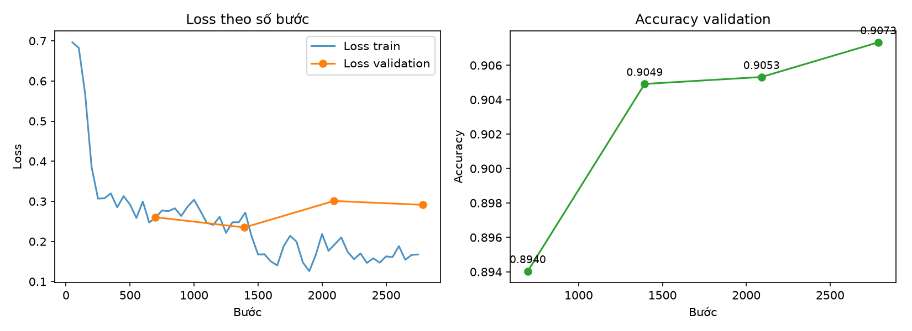
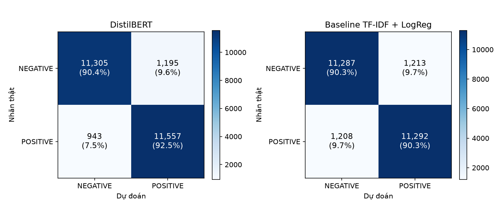

# Báo cáo thực hành Lab 3 – Get started with Hugging Face

**Nhóm E3_GROUP10** · Practice 3, Chương 4: Fine-tune Models and Training Algorithms · 09/11/2026

## Tóm tắt

| | Kết quả |
|---|---|
| **Bài 1** | Model `distilbert-base-uncased-finetuned-sst-2-english` phân loại đúng cả 3 câu mẫu, kể cả câu phủ định "not bad at all". Cách tự tính (tokenize → logits → softmax) khớp `pipeline()`, sai lệch 1,9 × 10⁻¹⁰ |
| **Bài 2** | Fine-tune `distilbert-base-uncased` trên 22.297 review IMDb, mất 1 giờ 11 phút trên Apple M1. Trên **25.000 review test: accuracy 0,9145, F1 0,9153** |
| So với baseline | Baseline TF-IDF + LogisticRegression đạt 0,9032. DistilBERT hơn 1,1 điểm, **có ý nghĩa thống kê** (McNemar, p ≈ 4,5 × 10⁻⁸) |
| Overfitting | Nhẹ: accuracy train cao hơn validation 0,062 |
| Hạn chế chính | Máy 8 GB RAM chỉ cho phép đọc 256 token đầu của mỗi review. Với 40% review dài hơn mức này, DistilBERT thua baseline |

---

## 1. Đề bài và cách tiếp cận

Đề gồm 2 bài (chi tiết: [docs/lab3-description.md](docs/lab3-description.md)):
- **Bài 1:** dùng model phân tích cảm xúc đã train sẵn trên Hugging Face Hub, tokenize một câu mẫu, phân tích cảm xúc của câu.
- **Bài 2:** fine-tune một model pretrained cho bài toán phân loại văn bản nhị phân, theo 7 bước, rồi đánh giá.

Nhóm làm dưới dạng project VS Code: code nằm trong `src/`, mỗi phần có tài liệu riêng trong `docs/`. Toàn bộ code và thí nghiệm tuân theo [RULES.md](RULES.md):
- chia dữ liệu trước mọi bước xử lý
- chỉ fit trên train
- dùng cross-validation
- không chọn tham số bằng tập test
- báo cáo cả điểm train và validation
- có seed để tái lập
- có pytest cho trường hợp thường, biên và input sai

Tổng cộng có 440 test, tất cả đều pass. Tiến trình từng bước được ghi trong [docs/AUDIT_LOG.md](docs/AUDIT_LOG.md).

## 2. Bài 1 – Phân tích cảm xúc bằng model đã train sẵn

Chi tiết: [docs/model.md](docs/model.md), phần Bài 1. Script: `python src/01_sentiment_analysis.py`.

| Bước của đề | Cách làm |
|---|---|
| 1. Cài transformers | `requirements.txt` (transformers 5.22.2) |
| 2. Model đã train sẵn | `distilbert/distilbert-base-uncased-finetuned-sst-2-english` (66,9 triệu tham số, 2 nhãn) |
| 3. Tokenize câu mẫu | *"I absolutely loved this movie, the cinematography was breathtaking!"* → 14 token, gồm `[CLS]`, `[SEP]` và mảnh WordPiece `breath` + `##taking` |
| 4. Phân tích cảm xúc | `input_ids` → model → logits → softmax tự cài đặt → nhãn. Đối chiếu với `pipeline("sentiment-analysis")` |

| Câu | Nhãn | Độ tin cậy |
|---|---|---|
| I absolutely loved this movie, the cinematography was breathtaking! | POSITIVE | 0,9999 |
| The plot was predictable and the acting felt painfully wooden. | NEGATIVE | 0,9998 |
| The film was not bad at all. | POSITIVE | 0,9975 |

Khi làm Bài 1, nhóm phát hiện **lỗi crash trên CPU** (Bus error). Nguyên nhân gốc: file trọng số của model có dữ liệu bắt đầu ở byte 12.518, không chia hết cho 4. transformers 5 ánh xạ thẳng file vào bộ nhớ, nên mọi tensor nằm ở địa chỉ lệch căn hàng, và PyTorch trên chip ARM crash khi nhân ma trận cho batch 1. Nhóm sửa bằng tham số chính thức `disable_mmap=True` và có test chống tái phát.

## 3. Bài 2 – Fine-tune DistilBERT

### 3.1 Dữ liệu

Chi tiết: [docs/data.md](docs/data.md).

- **Nguồn:** IMDb Large Movie Review Dataset (Maas và cộng sự, 2011), lấy bản `stanfordnlp/imdb` trên Hugging Face. Đây cũng là dataset của bài blog tham khảo trong đề.
- **Chia trước mọi bước xử lý:** tập test gốc (25.000 review) giữ nguyên. Tập train gốc được chia 90/10 có stratify (seed 42) thành train và validation. File gốc được **sắp theo nhãn**, nên bắt buộc phải xáo trộn trước khi chia.
- **Làm sạch:** thay thẻ ` ` bằng khoảng trắng.
- **Loại rò rỉ dữ liệu:** 123 review có mặt ở cả train gốc lẫn test, đã bỏ khỏi train và validation. Ngoài ra bỏ 78 bản trùng trong nội bộ train/validation và 20 review trùng giữa train với validation.
- **Kết quả:** train **22.297**, validation **2.482**, test **25.000** review, nhãn gần cân bằng.
- **Độ dài token (đo trên train):** trung vị 222 token. Nếu cắt ở 256 token thì 41,2% review bị cắt, cắt ở 512 thì 13,4%.

### 3.2 Baseline TF-IDF + LogisticRegression

Chi tiết: [docs/training.md](docs/training.md), phần A.

- TF-IDF nằm **trong** sklearn `Pipeline`, nên không rò rỉ dữ liệu khi cross-validation.
- Chọn tham số bằng **5-fold cross-validation chỉ trên train**, thử 8 bộ tham số. Tốt nhất là cụm 1–2 từ, C = 16, CV accuracy 0,9049 ± 0,0041. Đã kiểm chứng C = 16 là đỉnh: C = 64 và 256 đều cho điểm thấp hơn.
- Validation: accuracy 0,9098. Train: 0,9997, nên có cảnh báo overfitting (chênh 0,09). Đây là điều thường gặp ở mô hình tuyến tính có 100.000 đặc trưng.

### 3.3 Fine-tune DistilBERT theo 7 bước của đề

Chi tiết: [docs/training.md](docs/training.md) phần B, [docs/model.md](docs/model.md) phần Bài 2.

| Bước của đề | Cách làm |
|---|---|
| 1. Cài transformers, datasets, evaluate | `requirements.txt` |
| 2. Load dataset | `data/splits/train.csv`, `validation.csv` (không đọc test) |
| 3. Load model pretrained + tokenizer | `distilbert-base-uncased` (6 lớp, 66,9 triệu tham số) + đầu phân loại 2 nhãn khởi tạo mới |
| 4. Tiền xử lý | Tokenize, cắt ở 256 token, pad theo từng batch (`DataCollatorWithPadding`) |
| 5. Training arguments | Learning rate 2e-5 giảm tuyến tính, 10% bước đầu warmup; 2 epoch; batch 16; AdamW, weight decay 0,01; gradient clipping 1,0; đánh giá mỗi nửa epoch; early stopping (patience 2); seed 42 |
| 6. Trainer + fine-tune | `Trainer` của Hugging Face, metric tính bằng thư viện `evaluate`, nạp lại checkpoint tốt nhất theo validation |
| 7. Đánh giá | Trên validation và train (mục 3.4), rồi trên test một lần duy nhất (mục 3.5) |

**Chọn `max_length` bằng đo đạc thật** (lệnh chạy thử `--smoke`):
- 256 token: ước tính 1 giờ 17 phút, thực tế mất 1 giờ 11 phút.
- 512 token: hết RAM, máy phải dùng tới 7,3 GB swap, mỗi bước chậm từ 3 giây lên 120 giây, nên không khả thi.

### 3.4 Quá trình train

| Bước | Accuracy validation | Loss validation |
|---|---|---|
| 697 | 0,8940 | 0,260 |
| 1.394 (hết epoch 1) | 0,9049 | **0,235** |
| 2.091 | 0,9053 | 0,301 |
| 2.788 (hết epoch 2) | **0,9073** | 0,291 |

| Model tốt nhất | Accuracy | F1 |
|---|---|---|
| train | 0,9692 | 0,9694 |
| validation | 0,9073 | 0,9081 |

**Overfitting nhẹ.** Train cao hơn validation 0,062, vượt ngưỡng 0,05 nên có cảnh báo. Loss validation tăng ở epoch 2 trong khi accuracy vẫn nhích lên: model ngày càng tự tin hơn mức cần thiết. Mức chênh vẫn thấp hơn baseline (0,090), và checkpoint được chọn theo validation.

### 3.5 Đánh giá trên tập test

Chi tiết: [docs/evaluation.md](docs/evaluation.md).

| Model | Accuracy | Precision | Recall | F1 |
|---|---|---|---|---|
| **DistilBERT fine-tune** | **0,9145** | 0,9063 | **0,9246** | **0,9153** |
| Baseline TF-IDF + LogReg | 0,9032 | 0,9030 | 0,9034 | 0,9032 |
| *Blog tham khảo của đề (3.000 mẫu train, 300 mẫu test)* | *0,88* | — | — | *0,89* |

- **Có ý nghĩa thống kê:** kiểm định McNemar trên các review hai model bất đồng (1.473 review chỉ DistilBERT đúng, 1.190 review chỉ baseline đúng) cho χ² = 29,86, p ≈ 4,5 × 10⁻⁸.
- **Theo độ dài review:**

  | Nhóm review | Số review | DistilBERT | Baseline |
  |---|---|---|---|
  | Đọc trọn (≤ 256 token) | 14.973 | **0,9347** | 0,9050 |
  | Bị cắt (> 256 token) | 10.027 | 0,8842 | **0,9004** |

  Khi đọc trọn review, DistilBERT hơn 3 điểm. Khi review bị cắt mất phần cuối, nơi người viết thường chốt ý, DistilBERT thua 1,6 điểm.
- **Lệch giữa hai nhãn:** DistilBERT hơi nghiêng về nhãn tích cực. Có 9,6% review tiêu cực bị đoán thành tích cực, so với 7,5% ở chiều ngược lại.
- **Phân tích lỗi:** nhiều review bị đoán "sai" với độ tin cậy trên 99% thực ra là **nhãn dữ liệu bị sai**. Ví dụ một review mở đầu *"This movie was pure genius"* lại mang nhãn tiêu cực, vì nhãn IMDb lấy theo số sao. Ngoài ra là các review mỉa mai, khen chê lẫn lộn, hoặc review rất dài.
- **Validation lệch so với test:** trên validation hai model ngang nhau, trên test DistilBERT hơn. Giả thuyết là validation có thể chung phim với train, nên TF-IDF được lợi nhờ học thuộc tên phim. Chưa kiểm chứng được vì dữ liệu không có mã phim.

### 3.6 Dự đoán review mới

Script `python src/03_predict_finetuned.py` nhận câu từ dòng lệnh, từ file, hoặc chế độ hỏi–đáp. Chi tiết: [docs/demo.md](docs/demo.md).

Với 5 câu mẫu, model đoán **đúng 4/5**, kể cả câu phủ định và câu khen chê lẫn lộn. Câu mỉa mai *"Oh great, another sequel nobody asked for"* bị đoán nhầm thành tích cực, nhưng độ tin cậy chỉ 58,6%.

## 4. Đối chiếu với yêu cầu của đề

| Yêu cầu | Đáp ứng | Bằng chứng |
|---|---|---|
| Bài 1.1 Cài transformers | ✅ | `requirements.txt` |
| Bài 1.2 Dùng model sentiment pretrained từ Hub | ✅ | `src/lab3/sentiment.py` → `load_sentiment_model` |
| Bài 1.3 Tokenize câu mẫu | ✅ | Bảng token / `input_ids` / `attention_mask` trong `docs/model.md` |
| Bài 1.4 Phân tích cảm xúc | ✅ | Tự tính và qua `pipeline()`, hai cách khớp nhau |
| Bài 2.1 Cài transformers, datasets, evaluate | ✅ | `requirements.txt`; `evaluate` dùng để tính metric trong `Trainer` |
| Bài 2.2 Load dataset nhị phân | ✅ | IMDb, `src/lab3/data.py` |
| Bài 2.3 Load model pretrained + tokenizer | ✅ | `load_base_model` |
| Bài 2.4 Tiền xử lý | ✅ | `frame_to_dataset` |
| Bài 2.5 Training arguments | ✅ | `build_training_arguments` |
| Bài 2.6 Trainer + fine-tune | ✅ | `run_training`; model ở `outputs/final_model/` |
| Bài 2.7 Đánh giá model đã fine-tune | ✅ | Validation, train và test; `docs/evaluation.md` |

**Liên hệ với bài giảng Chương 4:**

| Nội dung bài giảng | Áp dụng trong bài |
|---|---|
| Fine-tuning / transfer learning | Có: đầu phân loại mới trên DistilBERT pretrained |
| Đóng băng rồi mở dần các lớp | **Không làm.** Nhóm fine-tune toàn bộ model với learning rate nhỏ, là cách chuẩn cho BERT khi dữ liệu đủ lớn (22.297 mẫu) |
| Optimizer AdamW, weight decay | Có |
| Lịch learning rate | Có: giảm tuyến tính kèm warmup |
| Batching, shuffling | Có: `Trainer` tự xáo trộn; pad theo từng batch |
| Dropout, early stopping | Có |
| Gradient clipping | Có: `max_grad_norm=1.0` |
| Data augmentation | Không làm: các kỹ thuật trong bài giảng dành cho ảnh |

Code mẫu ở mục 8 của bài giảng đã được cập nhật theo transformers 5: đổi `evaluation_strategy` thành `eval_strategy`, `tokenizer=` thành `processing_class=`, và tự tạo tập validation vì IMDb không có sẵn.

## 5. Hạn chế

1. **Chỉ đọc 256 token đầu** (máy 8 GB RAM không chạy nổi 512), nên mất phần cuối của 40% số review. Đây là nguyên nhân chính khiến model chưa đạt mức khoảng 92,8% của bài báo DistilBERT.
2. **Model quá tự tin:** loss validation tăng ở epoch 2, có những lần đoán sai mà tự tin trên 99%. Có lẽ 1 epoch là đủ.
3. **Chỉ train 1 lần với 1 seed**, nên chưa đo được độ dao động khi đổi seed (thường khoảng ±0,3 điểm).
4. **Validation có thể chung phim với train** (dữ liệu không có mã phim), nên điểm validation chưa phản ánh đúng hoàn toàn. Tập test thì sạch.
5. **Chưa xử lý tốt câu mỉa mai.** Một phần lỗi còn đến từ nhãn dữ liệu bị sai, ngoài khả năng của model.

## 6. Hướng cải thiện

1. Giữ **128 token đầu + 128 token cuối** thay vì 256 token đầu. Cách này hiệu quả trên IMDb (Sun và cộng sự, 2019), không tốn thêm bộ nhớ, và cần chọn bằng validation.
2. Dùng máy có GPU nhiều bộ nhớ hơn (vd Colab, Kaggle) để chạy được 512 token.
3. Thử 1 epoch, hoặc học lại vài seed để báo cáo trung bình ± độ lệch chuẩn.
4. Kết hợp DistilBERT với baseline: 2.663 review chỉ một trong hai model đoán đúng.

## 7. Kết luận

Nhóm đã hoàn thành đầy đủ cả hai bài theo đúng các bước của đề. Model DistilBERT fine-tune đạt **accuracy 0,9145 và F1 0,9153** trên 25.000 review test chưa từng thấy. Kết quả này tốt hơn baseline có ý nghĩa thống kê, và tốt hơn mốc 88% của bài tham khảo. Mọi lựa chọn đều dựa trên train / validation, tập test chỉ dùng một lần. Điểm yếu lớn nhất (giới hạn 256 token) đã được đo, giải thích bằng số liệu, và có hướng khắc phục cụ thể.

## 8. Tài liệu tham khảo

- Maas, A. L., Daly, R. E., Pham, P. T., Huang, D., Ng, A. Y., & Potts, C. (2011). *Learning Word Vectors for Sentiment Analysis*. ACL 2011.
- Sanh, V., Debut, L., Chaumond, J., & Wolf, T. (2019). *DistilBERT, a distilled version of BERT: smaller, faster, cheaper and lighter*. arXiv:1910.01108.
- Sun, C., Qiu, X., Xu, Y., & Huang, X. (2019). *How to Fine-Tune BERT for Text Classification?* CCL 2019.
- Hugging Face. *Getting Started with Sentiment Analysis using Python*. https://huggingface.co/blog/sentiment-analysis-python
- Hugging Face Transformers documentation. https://huggingface.co/docs/transformers

## 9. Tài liệu chi tiết

| File | Nội dung |
|---|---|
| [docs/lab3-description.md](docs/lab3-description.md) | Đề bài, tài liệu tham khảo, quyết định của nhóm |
| [docs/data.md](docs/data.md) | Nguồn dữ liệu, cách chia, làm sạch, loại trùng |
| [docs/model.md](docs/model.md) | Model Bài 1, kiến trúc DistilBERT |
| [docs/training.md](docs/training.md) | Baseline, siêu tham số, quá trình train |
| [docs/evaluation.md](docs/evaluation.md) | Kết quả test, phân tích |
| [docs/demo.md](docs/demo.md) | Cách chạy, ví dụ, xử lý sự cố |
| [docs/MONITORS_DIAGRAM.md](docs/MONITORS_DIAGRAM.md) | Sơ đồ quy trình và giám sát |
| [docs/AUDIT_LOG.md](docs/AUDIT_LOG.md) | Nhật ký từng bước, các lỗi đã tìm và sửa |
| [notebooks/Practice3_HuggingFace_Final.ipynb](notebooks/Practice3_HuggingFace_Final.ipynb) | Notebook tổng hợp (đã chạy sẵn kết quả) |
