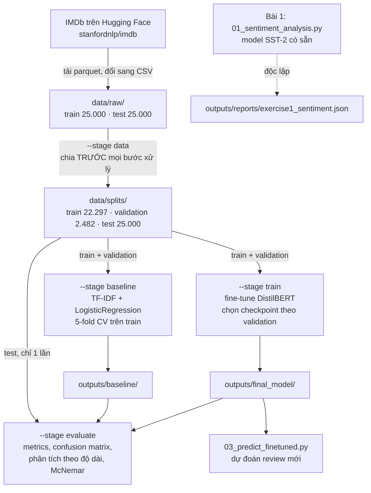
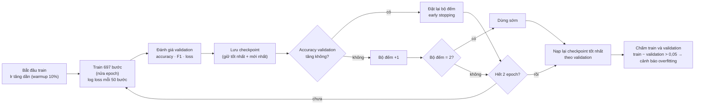

# Sơ đồ quy trình và giám sát

> Ghi chú: tên file lấy theo project mẫu (tên gốc bị cắt: `MONITORS_DIAGRAM_...`). Nhóm hiểu đây là sơ đồ quy trình và các điểm giám sát (monitor) của bài, nên trình bày 3 sơ đồ dưới đây. Các sơ đồ viết bằng Mermaid, VS Code (cài extension Markdown Preview Mermaid) và GitHub hiển thị được thành hình.

## 1. Toàn bộ quy trình

## 2. Giám sát trong lúc fine-tune

Trong lần train thật: đánh giá 4 lần (accuracy 0,8940 → 0,9049 → 0,9053 → 0,9073). Accuracy tăng ở mọi lần đánh giá nên early stopping không kích hoạt. Checkpoint tốt nhất là bước 2.788.

## 3. Các điểm kiểm soát chất lượng

| Điểm kiểm soát | Kiểm tra gì | Ở đâu |
|---|---|---|
| Rò rỉ dữ liệu | Review trùng giữa train / validation / test bị loại (123 review trùng với test) | `data.py` → `remove_duplicates` |
| Chia trước xử lý | Chia dữ liệu trước khi làm sạch, tokenize, thống kê | `data.py` → `prepare_data` |
| Fit chỉ trên train | TF-IDF nằm trong `Pipeline`, học lại ở từng fold | `baseline.py` |
| Tập test dùng 1 lần | Chỉ giai đoạn `evaluate` đọc `test.csv` | `02_train_finetune.py` |
| Overfitting | So accuracy train với validation, ngưỡng 0,05 | `evaluate.py` → `overfitting_gap` |
| Tái lập | Seed 42, SHA-256 của các file data | `config.py`, `data.md` |
| Thời gian / bộ nhớ | Chạy thử `--smoke` đo tốc độ trước khi train thật | `train.py` → `StepTimer` |
| Code đúng | 400+ test pytest (thường, biên, input sai) | `tests/` |
| Nhật ký | Mỗi bước ghi 5 giai đoạn Description → Gen → Smoke → Run → Check | `AUDIT_LOG.md` |
