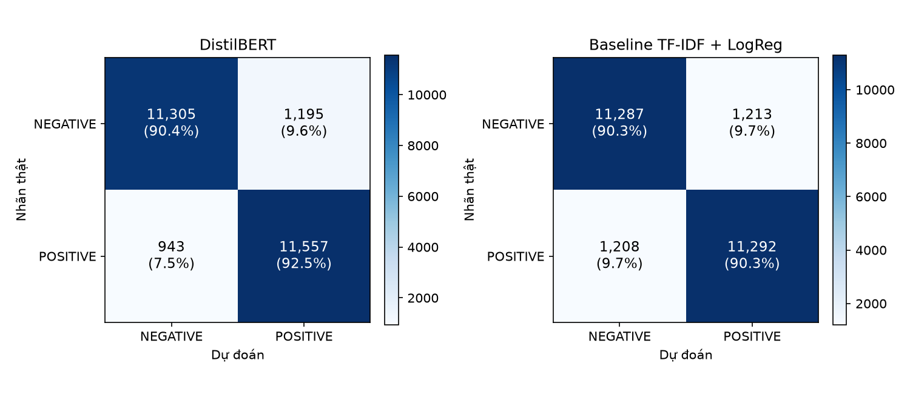
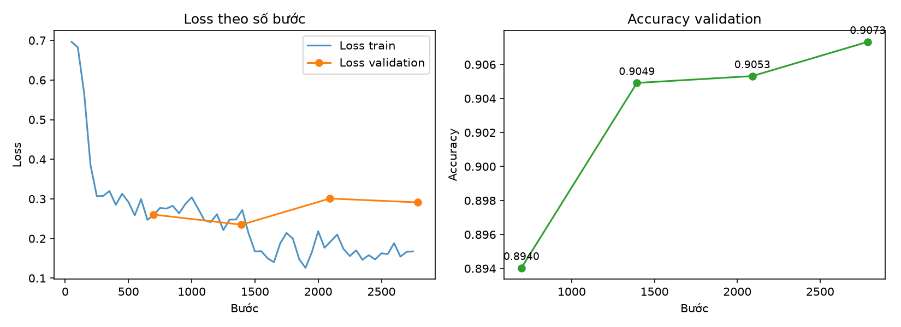

# Đánh giá trên tập test

Bước 7 của đề, *"Evaluate the finetuned model"*, phần đánh giá cuối.

Code: [src/lab3/final_evaluation.py](../src/lab3/final_evaluation.py), [src/lab3/plots.py](../src/lab3/plots.py). Chạy bằng lệnh:

```bash
python src/02_train_finetune.py --stage evaluate
```

## 1. Nguyên tắc

- Tập test (25.000 review của IMDb, không trùng với train/validation, xem [data.md](data.md)) **chỉ chạy một lần**, sau khi đã chốt mọi lựa chọn bằng train và validation: tham số baseline, `max_length`, checkpoint DistilBERT.
- `max_length` khi chấm được đọc từ báo cáo train (256), không chọn lại.
- Kết quả dưới đây **chỉ để báo cáo**. Nhóm không chỉnh model nào sau khi xem kết quả test.

## 2. Kết quả chính

| Model | Accuracy | Precision | Recall | F1 |
|---|---|---|---|---|
| **DistilBERT fine-tune** | **0,9145** | 0,9063 | **0,9246** | **0,9153** |
| Baseline TF-IDF + LogisticRegression | 0,9032 | 0,9030 | 0,9034 | 0,9032 |

(Precision, recall, F1 tính cho nhãn POSITIVE.)

**DistilBERT hơn baseline 1,1 điểm accuracy và 1,2 điểm F1.** Trên 25.000 review, mức chênh này tương ứng 283 review được đoán đúng thêm.

Để tham khảo:
- Bài blog trong đề đạt accuracy 88% khi train 3.000 mẫu và chấm 300 mẫu.
- Bài báo DistilBERT (Sanh và cộng sự, 2019) báo cáo khoảng 92,8% trên IMDb, nhưng dùng 512 token (đọc gần trọn review).

## 3. Confusion matrix



| | DistilBERT | Baseline |
|---|---|---|
| Review tiêu cực bị đoán thành tích cực | 1.195 (9,6%) | 1.213 (9,7%) |
| Review tích cực bị đoán thành tiêu cực | **943 (7,5%)** | 1.208 (9,7%) |

Baseline sai đều cả hai phía. DistilBERT giảm rõ số review tích cực bị đoán nhầm, nhưng hơi **nghiêng về nhãn tích cực**: số lỗi "tiêu cực → tích cực" nhiều hơn số lỗi chiều ngược lại. Vì vậy recall (0,925) cao hơn precision (0,906).

## 4. Quá trình train



- **Loss train** giảm nhanh trong 200 bước đầu (0,70 xuống khoảng 0,30), rồi giảm chậm xuống khoảng 0,17.
- **Loss validation** thấp nhất ở cuối epoch 1 (0,235), sang epoch 2 tăng lên khoảng 0,29–0,30. Đây là dấu hiệu overfitting nhẹ: model ngày càng tự tin, kể cả ở những câu đoán sai.
- **Accuracy validation** vẫn tăng qua cả 4 lần đánh giá (0,894 → 0,9073), nên checkpoint cuối là checkpoint tốt nhất.

Chi tiết về overfitting (train 0,969 so với validation 0,907) xem [training.md](training.md), Phần B mục 4.

## 5. Theo độ dài review

| Nhóm review test | Số review | DistilBERT | Baseline |
|---|---|---|---|
| Không bị cắt (≤ 256 token) | 14.973 | **0,9347** | 0,9050 |
| Bị cắt (> 256 token) | 10.027 | 0,8842 | **0,9004** |
| Tất cả | 25.000 | **0,9145** | 0,9032 |

Kết quả lặp lại đúng hiện tượng đã thấy trên validation:
- Khi được đọc trọn review, DistilBERT hơn baseline **3 điểm**.
- Với 40% review dài hơn 256 token, DistilBERT chỉ thấy phần đầu nên thua baseline 1,6 điểm, vì baseline luôn đọc trọn review.

**Giới hạn 256 token (do máy 8 GB RAM) là điểm yếu chính của model.**

## 6. Hai model đúng / sai ở đâu

| | Số review |
|---|---|
| Cả hai cùng đúng | 21.389 (85,6%) |
| Chỉ DistilBERT đúng | 1.473 |
| Chỉ baseline đúng | 1.190 |
| Cả hai cùng sai | 948 (3,8%) |

Hai model sai ở những chỗ khá khác nhau (2.663 review chỉ một trong hai model đúng). Gộp hai model lại có thể còn cải thiện thêm, nhưng việc này nằm ngoài yêu cầu của đề.

**DistilBERT hơn baseline có phải do ngẫu nhiên không?** Nhóm dùng **kiểm định McNemar**, kiểm định chuẩn để so hai model trên cùng một tập test. Kiểm định này chỉ xét các review mà hai model bất đồng: 1.473 review chỉ DistilBERT đúng, 1.190 review chỉ baseline đúng. Nếu hai model tốt như nhau thì hai con số này phải xấp xỉ bằng nhau.

| Thống kê | Giá trị |
|---|---|
| χ² (có hiệu chỉnh liên tục) | 29,86 |
| p-value (χ²) | 4,6 × 10⁻⁸ |
| p-value (kiểm định nhị thức chính xác) | 4,5 × 10⁻⁸ |

p-value nhỏ hơn rất nhiều so với 0,05, nên **DistilBERT tốt hơn baseline có ý nghĩa thống kê**, không phải do may. Hàm tính: `mcnemar_test` trong [src/lab3/evaluate.py](../src/lab3/evaluate.py).

## 7. Phân tích lỗi: các review DistilBERT đoán sai mà tự tin nhất

Danh sách đầy đủ (5 ví dụ mỗi loại, kèm 300 ký tự đầu) nằm trong `outputs/reports/evaluation_report.json`, mục `most_confident_errors_distilbert`. Các nhóm lỗi chính:

1. **Nhãn của dữ liệu có thể sai.** Nhiều review DistilBERT đoán "tích cực" với độ tin cậy trên 99,6% nhưng nhãn gốc là "tiêu cực". Đọc nội dung thì thấy rõ là review khen, ví dụ *"This movie was pure genius. John Waters is brilliant."* Nhãn IMDb được suy ra từ số sao người xem chấm, nên có lúc số sao và lời viết không khớp nhau. Baseline cũng đoán "tích cực" ở các review này.
2. **Review khen chê lẫn lộn hoặc mỉa mai.** Ví dụ một review mở đầu bằng *"don't expect much and you won't be disappointed"* nhưng cuối cùng lại cho điểm thấp, hoặc review gọi phim là *"the most cheesiest movie"* nhưng ý là khen phim vui.
3. **Review dài, ý chính nằm ở cuối.** Có review dài tới 1.375 token, nghĩa là DistilBERT chỉ đọc được khoảng 1/5 nội dung. Điều này khớp với phân tích ở mục 5.

Ghi chú: một review xuất hiện 2 lần trong danh sách, vì tập test gốc có 201 bản trùng nội bộ mà nhóm giữ nguyên (xem [data.md](data.md), mục 9).

## 8. So sánh validation với test

| Model | Validation | Test | Chênh lệch |
|---|---|---|---|
| DistilBERT | 0,9073 | 0,9145 | +0,7 |
| Baseline | 0,9098 | 0,9032 | −0,7 |

Trên validation hai model ngang nhau, nhưng trên test DistilBERT hơn rõ. Giải thích có khả năng nhất (**giả thuyết, chưa kiểm chứng được** vì bản IMDb trên Hugging Face không có mã phim): validation được tách ngẫu nhiên từ train nên có thể chung phim với train. Baseline TF-IDF học thuộc được tên phim và tên diễn viên, nên được lợi trên validation. Tập test thì không chung phim nào với train, nên con số trên test phản ánh đúng hơn khả năng tổng quát hoá.

## 9. Kết luận

- DistilBERT fine-tune đạt **accuracy 0,9145, F1 0,9153** trên 25.000 review test. Kết quả này tốt hơn baseline TF-IDF (0,9032) và tốt hơn mốc 88% của bài blog tham khảo.
- Overfitting ở mức nhẹ (xem [training.md](training.md)). Checkpoint tốt nhất được chọn theo validation.
- Điểm yếu chính là giới hạn 256 token. Nếu có máy mạnh hơn (đọc được 512 token), hoặc giữ phần đầu + phần cuối review, kết quả nhiều khả năng còn tăng.

## 10. File đầu ra

| File | Nội dung |
|---|---|
| `outputs/reports/evaluation_report.json` | Toàn bộ số liệu ở trên |
| `outputs/reports/confusion_matrices.png` | Confusion matrix của 2 model |
| `outputs/reports/training_curves.png` | Loss và accuracy theo số bước |
| `outputs/reports/test_predictions.csv` | Dự đoán và xác suất của 2 model cho từng review test (truy lại bằng `source_index`) |
| `outputs/reports/evaluate_console.log` | Log terminal |
